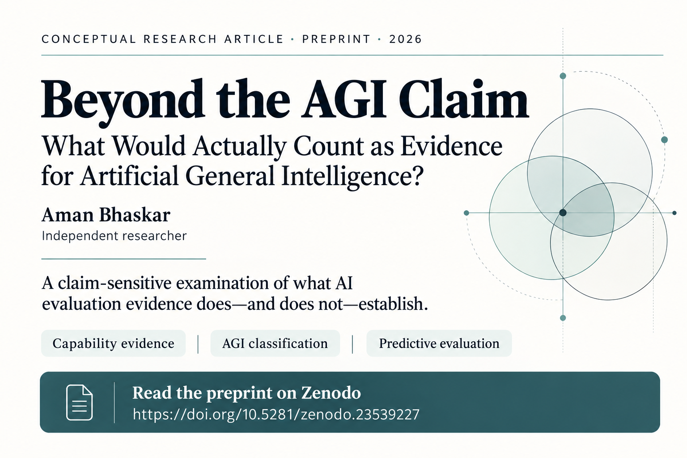

**Conceptual research article · Preprint · Version 1**  
**Aman Bhaskar** · *Independent researcher* · 21 October 2026  
[**Read the full preprint on Zenodo**](https://zenodo.org/records/23539227) · [DOI: 10.5281/zenodo.23539227](https://doi.org/10.5281/zenodo.23539227)

---

## Overview

When does evidence of broad AI performance justify a claim about artificial general intelligence (AGI)? This paper examines how the answer depends on the account of intelligence being used—and on the precise claim that the evidence is expected to support.

Through conceptual analysis of three published cases, the article examines how evidence can be meaningful without necessarily establishing every broader conclusion drawn from it. It focuses on the reasoning that connects an observed result to a claim, rather than attempting to issue a definitive verdict on whether a system is AGI.

## What the paper examines

| Case | Distinction examined |
|---|---|
| **Bubeck and colleagues’ early GPT-4 interpretation** | Immediate correction versus broader reuse of task prerequisites and general transfer. |
| **Hendrycks and colleagues’ cognitive-parity criterion** | Evidence supporting a storage score versus the role that score plays in an overall AGI classification. |
| **Zhou and colleagues’ prediction of language-model response success** | An evaluator’s ability to predict model performance versus evidence that the evaluated model itself has learned. |

Across the cases, the analysis applies three checks:

1. **Account adequacy:** Is the account of intelligence explicit and appropriate to the claim being assessed?
2. **Evidential support:** What does the cited result directly support, and what additional inference is being made?
3. **Conditions and claim scope:** Are the evaluation conditions and the scope of the original claim preserved when drawing the conclusion?

## Main contribution

The paper offers a **critical methodological synthesis with traceable case analyses**. It compares the evidential requirements of different accounts of intelligence and proposes a claim-sensitive way to inspect the path from observed evidence to a broader AI capability or AGI claim.

Its central argument is that when a requirement or premise changes materially, the affected inference should be reassessed. A dispute over one premise, however, does not automatically invalidate a separate conclusion that has independent support.

## Scope and limitations

- This is a **conceptual research article**, not an empirical experiment.
- The cases were selected purposively, and source inspection was selective.
- The proposed method and its practical benefits have **not been empirically validated**.
- The article does not establish a universal AGI threshold, claim to disprove AGI, or deliver a definitive AGI verdict on the systems discussed.

Further work would need to test the approach systematically—for example, by assessing whether independent reviewers using a structured audit can improve traceability, completeness, or agreement compared with unstructured reviews.

## Publication record

| Field | Details |
|---|---|
| **Author** | Aman Bhaskar |
| **Author designation** | Independent researcher |
| **Publication label** | Conceptual research article (preprint) |
| **Version** | v1 |
| **Record date** | 21 October 2026 |
| **Canonical record** | [Zenodo record 23539227](https://zenodo.org/records/23539227) |
| **DOI** | [10.5281/zenodo.23539227](https://doi.org/10.5281/zenodo.23539227) |

## How to cite

Bhaskar, A. (2026). *Beyond the AGI Claim: What Would Actually Count as Evidence for Artificial General Intelligence?* Conceptual research article (preprint). Zenodo. https://doi.org/10.5281/zenodo.23539227

---

*The Zenodo record is the canonical citable version of this preprint. This page is a concise repository summary; consult the linked record for the full paper and its reference list.*
